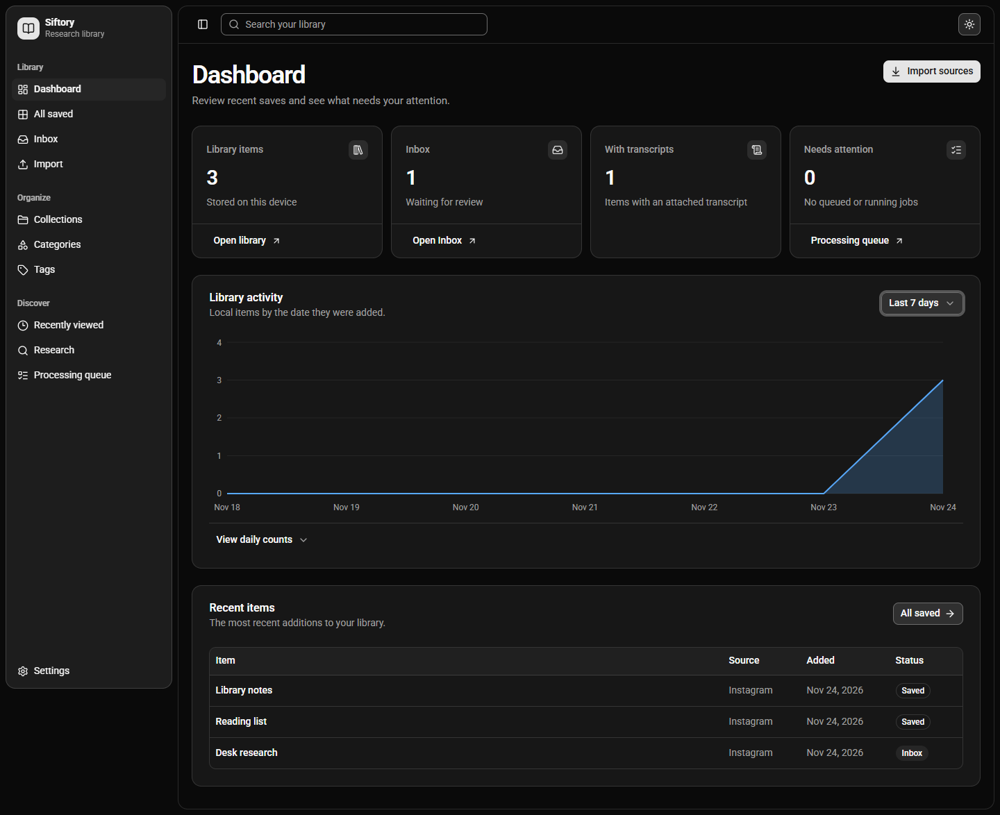

# Siftory

**Save less. Understand more.**

Siftory is a local-first research library for saved posts, links, documents, and transcripts. Import what you want to keep, review it in your Inbox, and find it again by searching or organizing it. Connect ChatGPT when you want a summary, key points, or an answer grounded in your saved sources.



## Quick start

Use Node.js 24 or newer. From the repository root, run:

```sh
npm ci
npm run dev
```

Open the local address printed by Vite, usually `http://localhost:5173`. Use the same browser profile and address when reopening an existing library or ChatGPT connection.

## What you can do

| Area | Workflow |
| --- | --- |
| **Import** | Preview Instagram JSON exports, browser bookmarks, web links, PDFs, and text files before saving them to the Inbox. Imports are parsed locally. |
| **Review** | Sort and filter your Inbox, move useful items to All Saved, and organize them with collections, categories, and tags. |
| **Transcripts** | Attach text, SRT, or WebVTT. Review timed segments and seek through source audio when a local recording is available. |
| **AI analysis** | Use your connected ChatGPT plan to summarize reviewed text, extract key points with source quotes, and suggest categories. Use **App links** to check selected names or store listings. |
| **Research** | Search saved captions, transcripts, and extracted text locally. Review the source excerpts before requesting a cited answer from ChatGPT. |

The processing queue supports local plain-text extraction and shows the status of analysis jobs.

## Storage and privacy

The library starts in browser storage. For the existing seven-import migration, open **Settings → Local storage → Move seven imports to SQLite** in the browser where those items are visible. Siftory matches them against your local `data.json`, verifies a backup in `.siftory/backups/`, and checks the migrated records before switching to SQLite.

The SQLite file is `.siftory/library.sqlite3`. Settings shows the database size, attachments, referenced audio, and space SQLite can reuse. Keep the original browser data and its backup for recovery. SQLite data, local exports, generated media, and the `.agents/` skills directory are Git-ignored.

### ChatGPT connection

Connect from **Settings → ChatGPT connection**. On Windows, the local server encrypts the renewable session with Windows DPAPI so it can restore the connection after a restart. OpenAI can expire or revoke the grant at any time. The library works independently of ChatGPT, and sending text for analysis or research requires a separate review and confirmation.

If an analysis fails, open **Processing queue → Error details** and match the request ID to the `[Siftory AI]` entry in the local server terminal. Diagnostics omit source text, model responses, and credentials. Siftory keeps supported findings when an optional quote fails validation and requires an exact source quote for the summary.

App lookup sends only your selections. Name searches use Apple’s public catalog, and direct Google Play links can also be checked.

## Optional media transcription

The local media trial uses Python 3.12+, FFmpeg, `yt-dlp`, and `faster-whisper`. It can transcribe a local media file or try an accessible Instagram post or Reel. Instagram access is unofficial and can change. Use it only for media you are permitted to process. The first run downloads the speech model, then transcription runs on this device.

```powershell
python -m venv .siftory/media-venv
.siftory/media-venv/Scripts/python.exe -m pip install -r scripts/media-requirements.txt
.siftory/media-venv/Scripts/python.exe scripts/media_trial.py --file path/to/video.mp4 --model base
```

Use `--url` for one Instagram link, `--instagram-json path/to/saved.json --max-items 20` for a batch, or `--audio-only` to skip transcription. Output goes to `.siftory/media/`. While Siftory is open, it checks for newly generated transcripts and attaches them to matching Instagram items that have no transcript. [Media trial setup and options](docs/phases/PHASE-6-LOCAL-MEDIA-TRIAL.md)

## Development

Siftory uses React, TypeScript, Vite, and shadcn/ui. The shared light and dark palettes live in [the theme stylesheet](src/styles/theme.css).

```sh
npm run lint
npm test
npm run build
npm run test:browser
```

The browser check uses installed Chrome and synthetic data. Set `SIFTORY_CHROME_PATH` for a nonstandard Chrome installation. Screenshots go to `test-results/shadcn/`.

| Topic | Documentation |
| --- | --- |
| Product and scope | [Product](docs/PRODUCT.md) · [Requirements](docs/REQUIREMENTS.md) |
| Architecture and decisions | [Architecture](docs/ARCHITECTURE.md) · [Data model](docs/DATA_MODEL.md) · [Decisions](docs/DECISIONS.md) |
| Interface | [Design system](docs/DESIGN_SYSTEM.md) · [UI and workflows](docs/UI_UX.md) |
| Project work | [Phase plan](docs/PLAN.md) · [Setup notes](docs/PROJECT_SETUP.md) · [Working agreement](AGENTS.md) |
